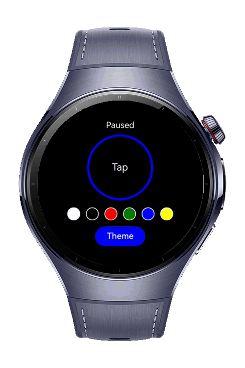
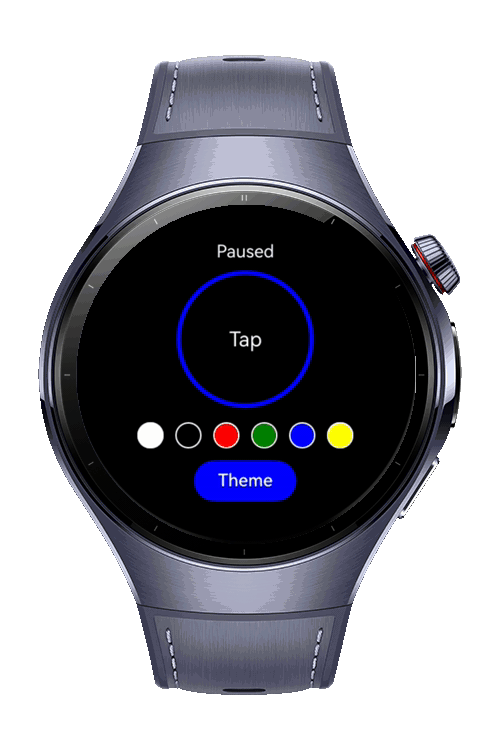
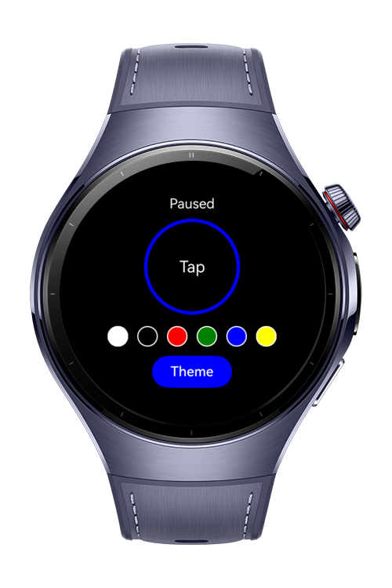

> **Note:** To access all shared projects, get information about environment setup, and view other guides, please visit [Explore-In-HMOS-Wearable Index](https://github.com/Explore-In-HMOS-Wearable/hmos-index).

# How to use Animator

A minimal, one-tap breathing & focus aid for **HarmonyOS wearables**. The app shows a smooth, looping **pulse ring** animation. Tap to start/pause, switch themes, and pick the ring color from quick swatches.


# Preview
<div>
  
  
  
  
</div>

# Use Cases
- Tap the ring to **start/pause** a calm pulse animation
- **Switch themes** (light/dark/gray) to match environment
- **Pick ring color** via quick swatches
- Run short **micro-breaks** or focus sessions without menus
- **Battery-friendly** and distraction-free visuals

# Tech Stack

**Languages:** ArkTS, ArkUI  
**Frameworks:** HarmonyOS SDK 5.0.2(14)  
**Tools:** DevEco Studio Version 5.1.0.828  
**Libraries:**
- `@kit.ArkUI` (Animator via `UIContext.createAnimator`)

# Directory Structure
```
entry/
├── src/main/ets/
│ ├── pages/
│ │ └── Index.ets // PulseRing main screen (wearable-optimized)
│ │
│ ├── viewmodel
│ │ └── SettingsVM.ets 
│ │
│ ├── model/ // (optional) entities
│ │ └── Preset.ets 
│ │
│ └── utils/ // (optional) helpers 
│   └── ColorUtils.ets 
│   └── Logger.ets 
│
└── src/main/resources/
```

# Constraints and Restrictions
## Supported Device
- Huawei watch 5

# LICENSE

**Pulse Ring** is distributed under the terms of the **MIT License**.  
See the [LICENSE](/LICENSE) for more information.